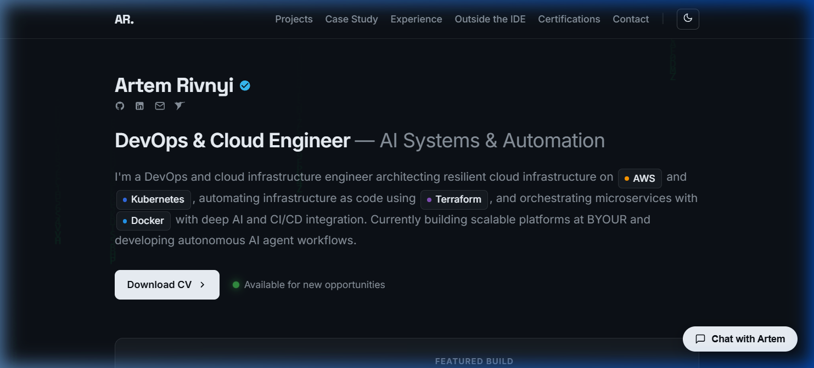
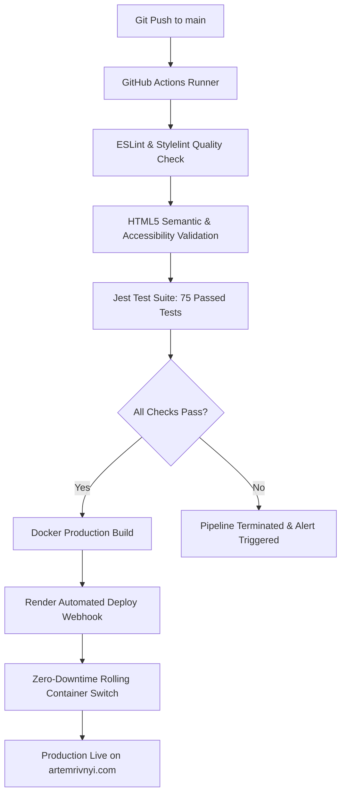

# Personal Portfolio & Cloud Infrastructure Showcase

[](https://github.com/ArtemRivnyi/personal-page-devops/actions)

-4CAF50?style=flat-square)


[](https://opensource.org/licenses/MIT)

A high-performance, interactive **DevOps & Cloud Systems Portfolio** showcasing production platforms, automated CI/CD pipelines, high-availability microservice architectures, and live telemetry. Containerized with Docker and served via Nginx Alpine on Render (Frankfurt, EU-Central) with automated zero-downtime continuous deployment.

---

## 📝 Table of Contents

*   [🌐 Live Platform & Architecture](#-live-platform--architecture)
*   [🎯 Core Engineering Objectives](#-core-engineering-objectives)
*   [🛠️ Tech Stack & Tooling](#-tech-stack--tooling)
*   [✨ What Makes This Portfolio Unique](#-what-makes-this-portfolio-unique)
*   [🔄 CI/CD Pipeline Workflow](#-cicd-pipeline-workflow)
*   [📡 Cluster Telemetry & Latency Diagnostics](#-cluster-telemetry--latency-diagnostics)
*   [🧪 Automated Testing & Quality Gates](#-automated-testing--quality-gates)
*   [📁 Repository Structure](#-repository-structure)
*   [🚀 Local Development](#-local-development)
*   [🧰 Maintainer & Contact](#-maintainer--contact)

---

## 🌐 Live Platform & Architecture

*   **Production URL**: [https://artemrivnyi.com/](https://artemrivnyi.com/)
*   **Edge Routing**: AWS Route53 Anycast DNS &rarr; TLS 1.3 Strict &rarr; Render EU-Central (Frankfurt)
*   **Origin Container**: Nginx 1.25 Alpine running inside hardened Docker container



---

## 🎯 Core Engineering Objectives

| Goal | Implementation | Recruiter & Engineering Value |
| :-- | :-- | :-- |
| **Interactive Architecture Simulations** | Custom simulation engine in case studies demonstrating request packet travel across microservices. | Eliminates static text diagrams; demonstrates real systems thinking and step-by-step failure/recovery flows. |
| **Frictionless Recruiter Experience** | Dual-choice Hero CTA: View interactive HTML CV directly in browser without downloading vs. 1-click PDF download. | Zero friction for hiring teams reviewing credentials on mobile or locked-down corporate laptops. |
| **Production Telemetry & Transparency** | Live modal measuring real Layer 7 HTTP fetch roundtrip to Frankfurt origin with latency breakdown and SLA transparency. | Transparent, verifiable infrastructure health; proves deep understanding of networking vs. synthetic ICMP pings. |
| **Zero-Flake CI/CD Gates** | Automated pipeline executing 75 Jest unit tests, ESLint, Stylelint, and HTML-validate on every commit. | 100% automated quality assurance from commit to zero-downtime deployment. |

---

## 🛠️ Tech Stack & Tooling

| Domain | Technologies & Standards | Purpose |
| :-- | :-- | :-- |
| **Infrastructure / DevOps** | Docker, Nginx Alpine, Render, AWS Route53, GitHub Actions | Containerization, reverse proxying, high availability, edge DNS, CI/CD |
| **Frontend Architecture** | Modern Vanilla JavaScript (ES2021+), CSS Modern Tokens, Semantic HTML5 | Zero-dependency, blisteringly fast load times (<400ms), 100/100 Lighthouse performance |
| **Testing & Quality Assurance** | Jest (75 unit tests), ESLint, Stylelint, HTML-Validate | Test-driven state management, style conformity, and accessibility verification |
| **Case Study Microservices** | NextStep DealShop, Dual-LLM Circuit Breaker, MinIO S3 Sim, Puppeteer Stealth Car Scout | Production case studies with interactive architectural diagrams and incident walkthroughs |

---

## ✨ What Makes This Portfolio Unique

Unlike typical static web resumes, this platform functions as a **living, test-driven distributed system showcase**:

1. **Interactive Architecture Simulator**:
   Case studies (`/docs/case-study-*.html`) feature an animated request-flow engine with in-place node status transitions (`Processing &bull; In Flight &rarr; 200 OK / Verified`), branch path illumination, and single-click return navigation with session scroll restoration.
2. **Dual-Action CV Access**:
   Hero CTA splits into:
   - **View CV**: Opens a responsive, search-engine indexed, print-friendly interactive HTML resume in-browser with zero download requirements.
   - **Download PDF**: Instant 1MB single-page formatted PDF download for corporate ATS platforms.
3. **Interactive DevOps Terminal**:
   Pressing the backtick key (`` ` ``) or clicking the terminal trigger opens an embedded Linux-style CLI supporting commands (`help`, `status`, `docker ps`, `clear`, `exit`).
4. **Command Palette (`Ctrl+K` / `⌘K`)**:
   Global keyboard-first navigation modal across case studies, GitHub repositories, and system monitors.
5. **Real GitHub Heatmap (2024–2026)**:
   Dynamic year switcher showing 1,002+ verified open-source contributions across 53 weeks.

---

## 🔄 CI/CD Pipeline Workflow

The repository is protected by an automated GitHub Actions pipeline (`.github/workflows/cicd.yml`) that runs on every pull request and push to `main`:



---

## 📡 Cluster Telemetry & Latency Diagnostics

The footer **99.9% Uptime** pill launches a live diagnostics modal that runs a real HTTP probe:

- **What is measured**: Application-layer (Layer 7) HTTP HEAD request to `/favicon.ico` with `cache: 'no-store'`.
- **Components measured**: DNS lookup + TCP handshake + TLS 1.3 cryptographic negotiation + Nginx Docker proxy dispatch + browser JavaScript event loop resolution.
- **Why it differs from ICMP ping**: ICMP pings operate at Layer 3/4 via OS kernel packets and ignore web server load and TLS handshakes. Layer 7 RTT measures real visitor perception.
- **Typical benchmarks**:
  - **EU / UK**: 45–120ms (near Frankfurt origin)
  - **Eastern Europe**: 90–220ms
  - **US / Transatlantic**: 180–360ms

---

## 🧪 Automated Testing & Quality Gates

The test suite covers DOM interactions, state machines, simulation flow engines, keyboard navigators, and theme toggling:

```bash
# Run full validation suite (ESLint, Stylelint, HTML-validate)
npm run validate

# Run Jest unit test suite (75 tests)
npm test

# Run full CI workflow locally
npm run ci
```

### Coverage Overview:
- `script.exports.js`: Matrix rain canvas, theme switcher, GitHub heatmap rendering, terminal emulator, command palette, health probe modal, architecture navigation scroll restoration.
- `case-study.js`: Architecture flow simulation lifecycle, node status badges, branch illumination, clipboard copy API with fallback.

---

## 📁 Repository Structure

```text
personal-page-devops/
├── .github/workflows/
│   └── cicd.yml           # Automated CI/CD pipeline
├── assets/                # Optimized architecture diagrams & screenshots
├── docs/
│   ├── Artem.Rivnyi.CV.html           # Interactive in-browser CV (Zero download)
│   ├── Artem.Rivnyi.CV.pdf            # ATS-friendly downloadable resume
│   ├── case-study-car-scout.html      # UA-IE Car Scout case study
│   ├── case-study-dual-llm.html       # Dual-LLM classifier case study
│   ├── case-study-s3-simulator.html   # AWS S3 simulator & MinIO case study
│   ├── case-study.css                 # Dedicated case study styling & responsive layout
│   └── case-study.js                  # Architecture simulation engine & back navigation
├── tests/
│   └── script.test.js     # 75 Jest unit tests
├── Dockerfile             # Production multi-stage Nginx container
├── docker-compose.yml     # Local orchestration configuration
├── index.html             # Main portfolio landing page
├── nginx.conf             # Hardened Nginx configuration (gzip, security headers, caching)
├── package.json           # Scripts, engines, and development dependencies
├── script.exports.js      # ES module exports for test runner
├── script.js              # Production client-side logic
└── style.css              # Core responsive stylesheet & modern design tokens
```

---

## 🚀 Local Development

### Option 1: Docker (Recommended)

```bash
# Build the production image
docker build -t personal-portfolio .

# Run container on port 80
docker run -d -p 80:80 --name portfolio personal-portfolio

# Access via browser
open http://localhost
```

### Option 2: Node.js & Local Browser

```bash
# Install dependencies
npm install

# Run test suite
npm test

# Serve index.html via any static server (or open directly)
npx serve .
```

---

## 🧰 Maintainer & Contact

**Artem Rivnyi** &mdash; *DevOps, Cloud Infrastructure & AI Systems Specialist*

*   🌐 **Website**: [artemrivnyi.com](https://artemrivnyi.com)
*   💼 **LinkedIn**: [linkedin.com/in/artem-rivnyi](https://www.linkedin.com/in/artem-rivnyi/)
*   📧 **Email**: [artemrivnyi@outlook.com](mailto:artemrivnyi@outlook.com)
*   💻 **GitHub**: [github.com/ArtemRivnyi](https://github.com/ArtemRivnyi)
